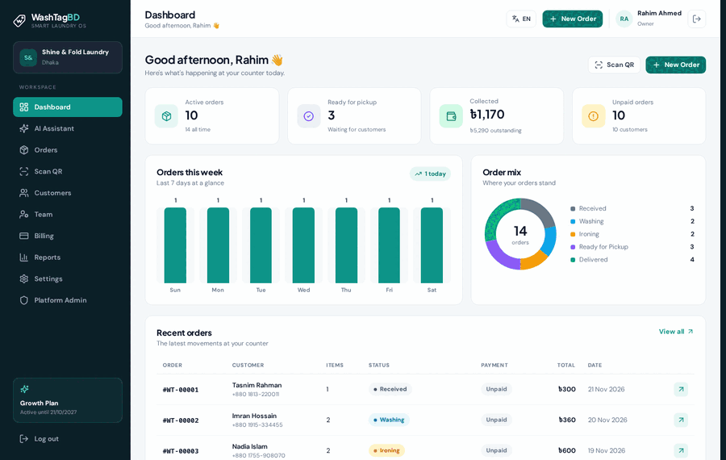
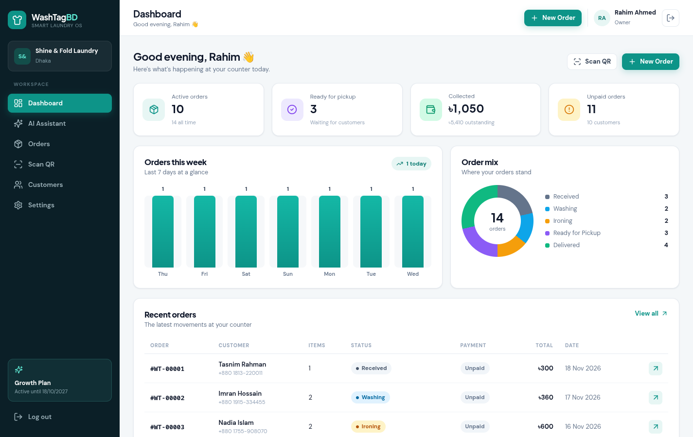
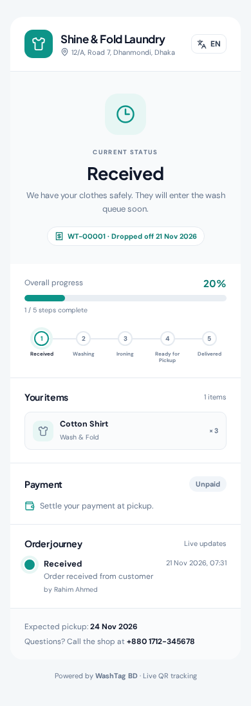
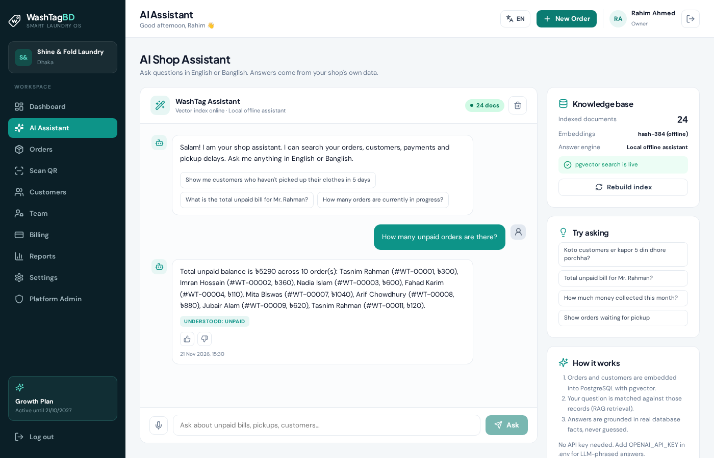
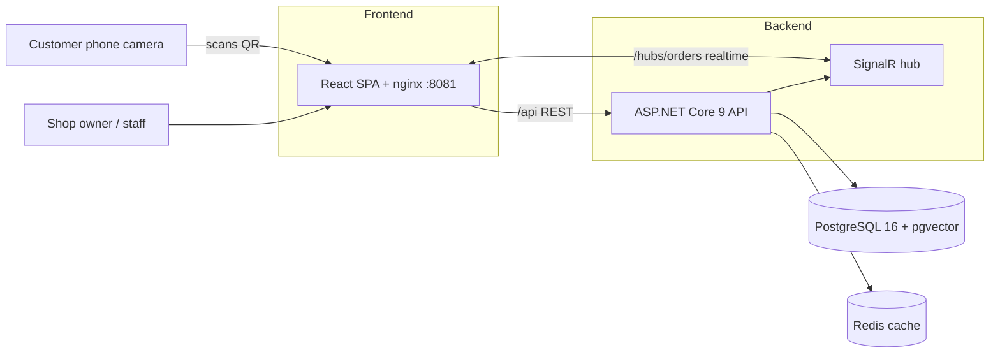

# WashTag BD — Smart Laundry & Tailor SaaS

[](https://github.com/RaiyanKhan19-41453-3/washtag-bd/actions/workflows/ci.yml)

A QR-code based order tracking platform built for laundry, dry-cleaning and tailor shops in Bangladesh. Customers scan a QR receipt with their phone camera and see the live status of their clothes — no app download required. Shop owners scan the same QR to move orders through the workflow and record payments.

Everything runs in Docker. You do **not** need Node, .NET, Postgres or Redis installed locally.

## See it in action



| Owner dashboard | Customer tracking (mobile) | AI Shop Assistant |
| --- | --- | --- |
|  |  |  |

### Architecture



---

## Quick start

```bash
cp .env.example .env      # optional for local demo; required for production (see DEPLOYMENT.md)
docker compose up --build -d
```

Open **http://localhost:8081** (change `APP_PORT` in `.env` if you prefer a different port)

The first build downloads base images and NuGet/npm packages, so it can take a few minutes. Subsequent starts are fast.

### Demo account (seeded automatically)

| Field | Value |
| --- | --- |
| Email | `demo@washtagbd.com` |
| Password | `demo1234` |

The demo shop comes preloaded with customers, orders in every status, payment history and status timelines, so the dashboard looks alive on first login.

To disable demo data, set `SEED_DEMO_DATA=false` **before the first start on a fresh volume**. Changing the flag later does not remove existing demo users — delete those rows manually if needed. Never recreate `pgdata` on a deployment that has real data: `docker compose down -v` deletes the entire database.

---

## Architecture

| Service | Technology | Purpose |
| --- | --- | --- |
| `web` | React 19 + Vite + nginx | Customer tracking page, owner dashboard, QR scanning |
| `api` | ASP.NET Core 9 Web API | Clean Architecture host: controllers, SignalR hub, JWT, QR endpoints |
| `postgres` | PostgreSQL 16 + **pgvector** | Durable tenant/order data (EF Core + Npgsql) and 384-dimension embeddings for RAG |
| `redis` | Redis 7 | Distributed cache for public tracking lookups |

Single entry point: nginx serves the SPA and reverse-proxies `/api/*` and `/hubs/*` to the API, so the browser has no CORS or mixed-origin issues.

```
Browser ──> web (nginx :8081) ──> /api/*  ──> api (:8080) ──> postgres
                              └─> /hubs/* ──> api (SignalR)
```

Every API request from the dashboard is scoped by the `shopId` claim embedded in the signed JWT. Public tracking is scoped by a per-order, unguessable GUID token — no shop data leaks.

### Backend structure (Clean Architecture)

```
backend/
├── Washtag.Domain/         Entities, enums, domain exceptions — zero dependencies
├── Washtag.Application/    DTOs, service interfaces, use-case services (incl. RAG orchestration)
├── Washtag.Infrastructure/ EF Core/Postgres, Redis, QRCoder, pgvector store, embeddings — implements interfaces
└── Washtag.Api/            Controllers, SignalR hub, JWT/auth, DI composition root
```

The dependency rule points inward: `Api → Infrastructure → Application → Domain`. Application services talk only to interfaces (`IAppDbContext`, `IRealtimeNotifier`, `ICacheService`, `IQrCodeService`, `ITrackingUrlProvider`), so the business logic stays testable and free of framework concerns.

---

## Features

**Shop owner**
- Register a shop, JWT login with 15-minute access tokens and rotating refresh tokens
- Invite/manage staff accounts with Owner/Staff roles and Owner-only guards
- Dashboard with live counts, revenue, 7-day trend and recent orders
- Create orders with multiple items, per-item service, quantity and price
- Auto-generated order number and unique QR receipt
- Status workflow: `Received → Washing → Ironing → Ready for Pickup → Delivered`
- Configurable service catalogue with per-service default prices (autofilled when creating orders)
- Pickup vs home-delivery mode with a delivery address on the order
- Daily register with payment-method/daily breakdowns and CSV export
- Camera QR scanning with manual token fallback; the scan screen can record payment and open the printable receipt inline
- Keyboard-accessible dialogs with focus trapping, visible focus rings, higher-contrast actions and reduced-motion support
- One-click 80mm thermal receipt with the QR at `/print/{token}` (print button uses the browser print dialog)
- Partial/full payment recording (Cash, Card, bKash, Nagad, Bank Transfer)
- Customer directory with totals and unpaid balances
- Shop profile settings and self-service password change

**Subscription & platform**
- Subscription state (plan, status, renewal date) with monthly invoices for Starter/Growth/Pro
- Owners can change plans and record manual invoice settlements (bKash/cash/card/bank); an online gateway can be added later
- Platform admin view (`/app/admin`) listing every shop, its plan, subscription and revenue, with Suspend / Reactivate / Cancel / Restore controls (cancel is final until explicitly restored)
- Subscription enforcement: expired, PastDue, Cancelled or suspended shops are locked from daily operations (403) but can still reach auth, billing and shop settings to renew — with a banner directing owners to the Billing page
- CORS origin allowlist, auth rate limiting (6 attempts/minute) and secure refresh-token rotation

**Customer**
- Scan QR → instant mobile page at `/track/{orderToken}` showing shop branding, item list, expected pickup, a live progress bar and status timeline
- Real-time updates over SignalR (with polling fallback)
- No account, no app download

**AI Shop Assistant** (`/app/assistant`)
- Ask in English or Banglish: *"Show me customers who haven't picked up their clothes in 5 days"*, *"What is the total unpaid bill for Mr. Rahman?"*
- Type or **speak** (browser Web Speech API; mic button)
- **RAG pipeline:** every order and customer becomes a vector document embedded into pgvector; questions are embedded and matched with cosine distance, then combined with deterministic database facts before answering
- Answers are grounded in real data — date ranges (`today`, `yesterday`, `this month`, `last week`) and revenue-by-payment-date are supported; offline mode suppresses weak vector citations and an LLM, when enabled, is instructed to treat computed facts as authoritative
- **Conversation history** is saved per user, with thumbs up/down feedback and a clear-history action
- Works fully **offline** with deterministic local embeddings and a grounded answer composer; optionally enable an `OPENAI_API_KEY` or `AI_GATEWAY_TOKEN` for LLM-phrased answers
- Index rebuilds automatically on every order/status/payment change, with a manual "Rebuild index" button

**Bengali UI**
- `EN / বাং` toggle in the sidebar, login and customer tracking page; persists per browser
- Navigation, dashboard, order statuses, assistant chrome and the customer tracking page are translated; other screens still use English with automatic fallback per string (contributions to `frontend/src/i18n/translations.js` welcome)

**Platform**
- Multi-tenant isolation and optimistic concurrency (conflicting updates return `409`)
- QR receipts generated server-side with QRCoder (data URL + printable PNG); they encode the real public `/track/{token}` URL of whatever host serves the app, so they work on localhost, a VPS IP or a custom domain
- Real-time push to both the owner dashboard and the customer tracking page
- Health-checked dependencies with automatic restarts, EF connection resiliency and retried startup/background indexing
- Database-backed idempotency keys stored on the order itself, so duplicate submissions are rejected atomically — even across API crashes and restarts — and replays return the original order
- Scheduled maintenance worker: marks overdue invoices and expired subscriptions, prunes old chat messages and refresh tokens, and reindexes shops so stale vector documents are removed — all idempotent and configurable with `MAINTENANCE_*` variables
- Swagger UI at `/swagger` (disabled by default; set `ENABLE_SWAGGER=true` to explore the API)

---

## Useful commands

```bash
docker compose logs -f api          # API logs
docker compose logs -f web          # nginx logs
docker compose ps                   # service status
docker compose restart              # restart everything
docker compose down                 # stop, keep data
docker compose down -v              # stop and delete all data
```

Rebuild after changing code:

```bash
docker compose up --build -d
```

### Backup and restore

```bash
./scripts/backup.sh                              # gzip dump in backups/ (keeps newest 7)
./scripts/restore.sh backups/washtag_....sql.gz  # DESTRUCTIVE: asks for confirmation
```

Both scripts read `POSTGRES_USER` / `POSTGRES_DB` from `.env` (with the compose defaults as fallback). Schedule `backup.sh` with cron on the host for real deployments, and store the dumps off-server.

`GET /health` returns `200 {"status":"healthy"}` when the API can reach the database, or `503` otherwise — useful for monitoring and load balancers.

### Tests and migrations

Everything is in one solution; .NET and Node are only needed if you want to develop outside Docker.

```bash
dotnet test tests/Washtag.Application.Tests/Washtag.Application.Tests.csproj   # 65 unit tests
dotnet test tests/Washtag.Api.Tests/Washtag.Api.Tests.csproj                   # 15 unit tests
# Integration tests (real Postgres + pgvector via Testcontainers — requires a running Docker daemon)
dotnet test tests/Washtag.Integration.Tests/Washtag.Integration.Tests.csproj   # 8 real-database tests
node scripts/load-test.mjs                                                   # optional load probe against a running stack

See [docs/verification.md](docs/verification.md) for load, multi-replica and upgrade-from-older-tag results.
cd frontend && npm run build       # production bundle check
```

For frontend-only development (`npm run dev`), Vite proxies `/api` and `/hubs` to `http://localhost:8081` (the running app's nginx) by default; set `VITE_API_TARGET` in `frontend/.env` to point at a different origin. NuGet lock files are committed and CI restores with `--locked-mode`.

Schema changes are managed with EF Core migrations in `backend/Washtag.Infrastructure/Data/Migrations`. The API applies pending migrations at startup (`db.Database.Migrate()`) and then seeds demo data. To create a new migration:

```bash
dotnet tool install --global dotnet-ef --version 9.0.1
dotnet ef migrations add MyChange --project backend/Washtag.Infrastructure --startup-project backend/Washtag.Api --output-dir Data/Migrations
```

> Upgrading from an older checkout that used `EnsureCreated()`? Existing volumes have no `__EFMigrationsHistory`, so `Migrate()` would fail on `InitialCreate`. Either back up and recreate the volume, or baseline it: create the history table and insert **exactly the IDs your existing schema actually contains** (for a v1.6.1-era `EnsureCreated()` volume that is the first seven below; the eighth is applied automatically on startup) (`20261118123245_InitialCreate`, `20261118131646_AddBilling`, `20261118144504_AddAssistantHistory`, `20261118185732_AddConcurrencyTokens`, `20261118191841_AddAssistantMessageMetadata`, `20261118210340_AddAssistantMessageForeignKeys`, `20261119092024_AddOrderIdempotencyKey`, `20261119131000_AddReportingIndexes`, `20261119191856_AddServicesAndDelivery`, `20261119195746_AddRefreshSessionBinding`, `20261119203443_AddCatalogueInitialized`) before starting the new API.

GitHub Actions runs build + tests + both Docker image builds on every push and PR to `main` (badge above).

---

## API surface

| Method | Endpoint | Auth | Description |
| --- | --- | --- | --- |
| POST | `/api/auth/register` | public | Create shop + owner account |
| POST | `/api/auth/login` | public | Get access + refresh tokens |
| POST | `/api/auth/refresh` | public | Rotate refresh token for a new access token |
| POST | `/api/auth/change-password` | JWT | Change password and revoke other sessions |
| GET | `/api/auth/me` | JWT | Current user + shop |
| GET | `/api/dashboard` | JWT | Dashboard aggregates |
| GET | `/api/orders` | JWT | Paginated, filterable order list |
| GET | `/api/orders/lookup/{token}` | JWT | Look up an order by QR token |
| GET | `/api/orders/{id}` | JWT | Order detail + timeline + payments + .NET-generated QR |
| GET | `/api/orders/{id}/qr` | JWT | QR receipt as a PNG (print/download) |
| POST | `/api/orders` | JWT | Create an order |
| PATCH | `/api/orders/{id}/status` | JWT | Advance/change status |
| POST | `/api/orders/{id}/payment` | JWT | Record a payment |
| DELETE | `/api/orders/{id}` | JWT | Cancel an order |
| GET | `/api/customers` | JWT | Customer directory |
| GET/PUT | `/api/shop` | JWT | Shop profile (PUT: Owner only) |
| GET | `/api/staff` | JWT | List team members |
| POST | `/api/staff` | Owner | Invite a staff account |
| PUT/DELETE | `/api/staff/{id}` | Owner | Edit or deactivate a team member |
| GET | `/api/billing` | JWT | Plan, status, invoices and outstanding balance |
| PUT | `/api/billing/plan` | Owner | Change subscription plan |
| POST | `/api/billing/invoices/{id}/pay` | Owner | Record manual invoice settlement |
| GET | `/api/admin/stats` | Platform admin | Cross-shop overview |
| PATCH | `/api/admin/shops/{id}/active` | Platform admin | Suspend (`active: false`) or reactivate (`active: true`) a shop |
| PATCH | `/api/admin/shops/{id}/cancel` | Platform admin | Cancel a shop's subscription (locks the shop) |
| PATCH | `/api/admin/shops/{id}/restore` | Platform admin | Restore a cancelled/past-due subscription (grants a fresh term) |
| POST | `/api/admin/maintenance/run` | Platform admin | Run scheduled housekeeping immediately (idempotent) |
| GET | `/api/public/track/{token}` | public | Customer-facing tracking payload |
| POST | `/api/assistant/ask` | JWT | Ask the RAG assistant a question |
| GET | `/api/assistant/status` | JWT | Vector index/engine status |
| GET | `/api/assistant/history` | JWT | Saved conversation for the current user |
| DELETE | `/api/assistant/history` | JWT | Clear the conversation |
| POST | `/api/assistant/feedback` | JWT | Rate an answer (thumbs up/down) |
| POST | `/api/assistant/reindex` | JWT | Rebuild the shop's vector index |
| GET | `/health` | public | API + database health check (503 when DB is down) |
| WS | `/hubs/orders` | optional | SignalR realtime updates |

Interactive docs are disabled by default. Set `ENABLE_SWAGGER=true` in `.env`, recreate the API container, then open **http://localhost:8081/swagger**.

---

## Access & security configuration

```env
# Comma-separated origins allowed by CORS; use your real domain in production
ALLOWED_ORIGINS=https://wash.example.com

# Comma-separated emails with platform-admin access (the demo owner by default)
ADMIN_EMAILS=demo@washtagbd.com

# Hide interactive API docs in production
ENABLE_SWAGGER=false

# Scheduled housekeeping (defaults shown)
MAINTENANCE_ENABLED=true
MAINTENANCE_INTERVAL_MINUTES=60
MAINTENANCE_RUN_ON_STARTUP=false
MAINTENANCE_CHAT_RETENTION_DAYS=90
```

Emails listed in `ADMIN_EMAILS` are reserved and cannot be self-registered. Deactivating an account or changing a password invalidates its existing access tokens immediately. Access tokens live for 15 minutes; refresh tokens last 30 days, are stored hashed, and rotate on every use. The client refreshes transparently on a 401. Auth endpoints are rate-limited to 6 attempts per minute per IP. Team management, plan changes, invoice settlement and order cancellation require the Owner role; `/api/admin/*` requires the `isAdmin` claim.

---

## AI configuration

The assistant runs with zero configuration using local hashed embeddings (384 dimensions) and grounded answers computed from your database. To have an LLM phrase the answers naturally, set **either** a direct OpenAI key **or** an AI Gateway token in `.env` and restart:

```env
# Option A: direct / OpenAI-compatible endpoint
OPENAI_API_KEY=sk-...
OPENAI_BASE_URL=https://api.openai.com/v1
OPENAI_EMBEDDING_MODEL=text-embedding-3-small
OPENAI_CHAT_MODEL=gpt-4o-mini

# Option B: AI Gateway (Vercel by default) — used when OPENAI_API_KEY is blank
AI_GATEWAY_TOKEN=...
AI_GATEWAY_URL=https://ai.gateway.vercel.app/v1
AI_GATEWAY_EMBEDDING_MODEL=text-embedding-3-small
AI_GATEWAY_CHAT_MODEL=gpt-4o-mini
```

`/api/assistant/ask` is limited to 20 requests/minute per user and `/api/assistant/reindex` to 2/minute per user (capped at 500 documents each) to bound AI costs. The embedding dimension stays at 384 in every mode, so the pgvector column never needs changing. If an API call fails, the assistant automatically falls back to the offline path. Conversations and feedback are stored per user in `AssistantMessages`.

---

## Production checklist

**Do not expose the default Compose setup publicly.** The base `docker-compose.yml` is a Development demo profile (seeded demo admin, self-settlement enabled); the strict Production profile is `docker-compose.prod.yml` and must be selected explicitly. See [DEPLOYMENT.md](DEPLOYMENT.md) for the full procedure; the short version:

- Copy `.env.example` to `.env` and set a strong `JWT_SECRET` (32+ characters), a strong `POSTGRES_PASSWORD`, `SEED_DEMO_DATA=false`, `ALLOWED_ORIGINS=https://your.domain` and `PUBLIC_BASE_URL=https://your.domain` **before the first start**. Leave `ADMIN_EMAILS` empty initially — see the bootstrap step below. Without a real JWT secret, every restart logs all users out.
- Set DB credentials before the first start — changing `POSTGRES_PASSWORD` later does not change the existing volume's password but does break the API connection.
- Start with `docker compose -f docker-compose.yml -f docker-compose.prod.yml up -d --build`, register your owner account, then set `ADMIN_EMAILS` to that address, restart the API and **log out and back in** so the new `isAdmin` claim is minted into the token.
- Use a TLS proxy on 80/443 and forward `X-Forwarded-For` / `X-Forwarded-Proto`; the web container binds only to `127.0.0.1:8081`.
- Browser camera and microphone access (Scan QR / Assistant voice input) require `localhost` or HTTPS in production.
- Production defaults `MANUAL_PAYMENT_ENABLED=false`: owners cannot mark their own invoices paid (there is no gateway verification). A platform admin settles invoices from the admin page instead. Keep it `true` only for a local demo.
- Optional `NOTIFICATION_WEBHOOK_URL` / `NOTIFICATION_WEBHOOK_TOKEN` send best-effort SMS/WhatsApp messages on new orders and ready/delivered transitions.
- Optional `PAYMENT_WEBHOOK_SECRET` enables verified gateway settlements: `POST /api/public/payments/webhook` requires `X-WashTag-Signature` (base64 HMAC-SHA256 of the raw body) and accepts `{"event":"invoice.paid","shopId":"…","invoiceId":"…","amount":123.45,"method":"Bkash","reference":"…"}` — `amount` must equal the invoice amount.
- Schedule `scripts/backup.sh` and store dumps off-server.
- Run **one API replica** — the maintenance worker, SignalR groups and rate limits are per-process.

### Troubleshooting

- **Port already in use:** change `APP_PORT` in `.env`, then `docker compose up -d`.
- **Blank page after code changes:** `docker compose up --build -d` rebuilds both images.
- **Start completely fresh:** `docker compose down -v && docker compose up -d`.

Built with care for Dhaka, Gulshan, Uttara, Chittagong — and every neighbourhood shop that deserves a paper-free counter.
